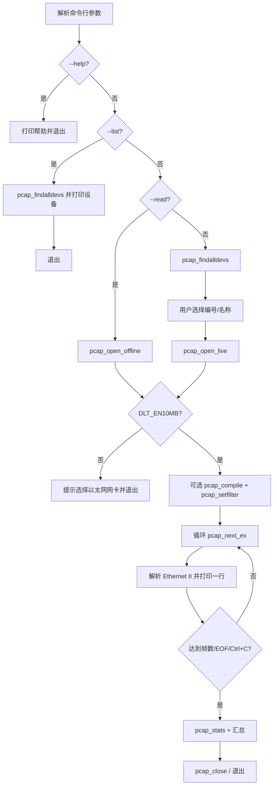

# 基于 NPcap 的以太网帧捕获实验报告

## 摘要

本实验在 Windows 平台上使用 NPcap 的 libpcap 兼容 API，实现了一个命令行以太网帧
捕获程序。程序首先通过 `pcap_findalldevs` 枚举本机网卡，用户可选择设备编号、pcap
设备名或网卡描述；随后用 `pcap_open_live` 打开网卡，可选安装 BPF 过滤器，并用
`pcap_next_ex` 循环读取数据帧。对每个 Ethernet II 帧，程序解析并显示源 MAC 地址、
目的 MAC 地址、类型/长度字段的值以及类型字段之后第一个字节的值；正常抓包过程不
写入任何文件，退出时输出接收、丢弃和畸形帧统计。

程序使用 C++17 编写，按“设备与捕获层 / 以太网帧解析层 / 命令行与显示层”划分模块，
并通过 RAII 管理 pcap 句柄和设备列表。帧解析部分有独立单元测试，覆盖 IPv4、ARP、
IPv6、VLAN、IEEE 802.3 长度字段和截断帧。随后在 Windows 11 ARM64 虚拟机中安装
Npcap 1.90，实际捕获了 ICMP 和 ARP 流量：ICMP 帧的类型字段为 `0x0800`、类型字段
后首字节为 `0x45`；ARP 帧的类型字段为 `0x0806`、首字节为 `0x00`。抓包期间
`pcap_stats` 显示 0 丢包。

---

## 1. 实验目的与要求

### 1.1 实验目的

1. 理解 NPcap 的体系结构：内核态 NPF 驱动、用户态 `Packet.dll` 和 `wpcap.dll`，
   以及 ndis 过滤驱动在协议栈中的位置。
2. 掌握 NPcap/libpcap 的设备枚举、网卡打开、过滤器安装和数据包捕获方法。
3. 使用 C++ 编写一个可实际运行的本机抓包程序，按 Ethernet II 格式解析并显示指定
   字段。
4. 通过实机抓包验证程序，并分析以太网帧各字段与上层协议的关系。

### 1.2 实验要求与实现对应

| 实验要求 | 本实验的实现 |
|---|---|
| 了解 NPcap 架构 | 第 3 章；用户态只调用 libpcap API，内核由 NPF 驱动完成 |
| 设备列表获取 | `pcap_findalldevs`，`--list` 模式或交互式选择 |
| 网卡设备打开 | `pcap_open_live`，设置 snaplen、混杂模式、读超时 |
| 数据包捕获 | `pcap_next_ex` 循环 + 可选 BPF 过滤 + 帧数上限 |
| 显示源/目的 MAC、类型字段、类型后首字节 | 第 7 章解析、第 8 章表格输出 |
| 不要求硬盘存储 | 正常路径只写 stdout；不调用 `pcap_dump` |
| 屏幕显示简单明确 | 固定列宽表格，每帧一行，退出时汇总统计 |
| 结构清晰、可读性 | 三层模块 + 独立单元测试 + RAII |

---

## 2. 实验环境

### 2.1 目标运行环境

| 项目 | 配置 |
|---|---|
| 操作系统 | Windows 10/11（x64 或 ARM64） |
| 抓包库 | Npcap 1.90 |
| 开发库 | Npcap SDK 1.17（`Include/`、`Lib/x64/`、`Lib/ARM64/`） |
| 编译器 | Visual Studio 2022（MSVC）或 MinGW-w64 |
| 构建工具 | CMake 3.16+ |
| 运行权限 | 管理员（NPcap 驱动默认限制管理员访问） |

### 2.2 实际验证环境

本次实验在一台 **Windows 11 ARM64 虚拟机**（Parallels Desktop，Windows 版本
10.0.26200）中完成实机验证：

- Npcap 1.90（ARM64 驱动），服务 `npcap` 状态为 `RUNNING`；
- 程序使用 Zig/LLVM 交叉编译为 ARM64 Windows 可执行文件；
- 网卡为 `Parallels VirtIO Ethernet Adapter`，链路类型 `DLT_EN10MB`；
- 抓包对象为虚拟机访问网关产生的 ICMP 和 ARP 帧。

同时，在 macOS（Darwin 24.6，Apple Clang 17，libpcap 1.10.1）上完成了
解析单元测试、ASan/UBSan 检查和离线 pcap 回放。macOS 与 Windows 使用同一套
libpcap API，因此涉及设备枚举、帧解析和显示逻辑的代码可以共用；真正运行 NPcap
驱动仍必须在 Windows 上。

### 2.3 源码组织

```text
.
├── CMakeLists.txt          # Windows / macOS / Linux 构建
├── Makefile                # macOS/Linux 快速构建
├── src/
│   ├── main.cpp            # 参数解析、设备选择、捕获循环、屏幕输出
│   ├── capture.h/.cpp      # pcap 设备枚举、打开、BPF、收包、统计
│   └── ethernet.h/.cpp     # Ethernet II 帧解析与字段格式化
├── tests/
│   └── ethernet_tests.cpp  # 帧解析单元测试
└── docs/
    ├── report.md           # 本报告
    └── live-capture.txt    # 实机输出记录
```

---

## 3. NPcap 体系结构

### 3.1 为什么抓包需要“架构”而不是普通库

应用程序正常收发数据时，数据经过 TCP/IP 协议栈，应用只能看到协议栈交付的载荷，
看不到以太网头、IP 头等原始字节。要在协议栈之外取得完整链路层帧，必须让一部分
代码运行在内核中，直接与网卡驱动和 NDIS 交互；同时还需要用户态 DLL 向应用程序
提供稳定的 API。因此 NPcap 由内核驱动和用户态库共同组成，官方将其称为一种
**体系结构（architecture）**，而不是单纯的库。

### 3.2 总体分层

```text
┌──────────────────────────────────────────────────────────────┐
│                         用户态                                │
│                                                              │
│   npcap_sniffer.exe                                          │
│        │  pcap_findalldevs / pcap_open_live / pcap_next_ex    │
│        ▼                                                     │
│   wpcap.dll  ── libpcap 兼容的高层 API                        │
│        │                                                     │
│        ▼                                                     │
│   Packet.dll ── 低层 API，向 NPF 驱动发 DeviceIoControl       │
│        │                                                     │
│        ├── NpcapHelper.exe / WlanHelper.exe（辅助工具）       │
│        └── NPFInstall.exe（安装/卸载驱动）                    │
└────────┼─────────────────────────────────────────────────────┘
         │  IOCTL / ReadFile
┌────────▼─────────────────────────────────────────────────────┐
│                         内核态                                │
│   npcap.sys（NPF，Netgroup Packet Filter）                    │
│   NDIS 6 Light-Weight Filter（LWF）驱动                       │
│        │                                                     │
│        ├── BPF 过滤器（JIT 编译）                             │
│        ├── 内核环形缓冲区                                     │
│        └── capture / injection / statistics                   │
└────────┼─────────────────────────────────────────────────────┘
         │
┌────────▼─────────────────────────────────────────────────────┐
│   NDIS  ──  网卡 miniport 驱动  ──  物理/虚拟网卡              │
│                                                              │
│   回环旁路：WFP callout → NPF_Loopback（DLT_NULL）            │
└──────────────────────────────────────────────────────────────┘
```

### 3.3 内核态：NPF 驱动

`npcap.sys`（NPF，Netgroup Packet Filter）是 NPcap 的核心，运行在内核态。它实现为
**NDIS 6 Light-Weight Filter（LWF）驱动**，注册在 NDIS 的过滤驱动层，位于协议驱动
（如 TCP/IP）和网卡 miniport 驱动之间。与 WinPcap 使用的旧 NDIS 5 中间层驱动相比，
LWF 使用 `NET_BUFFER_LIST` 数据结构，不需要在 `NDIS_PACKET` 之间反复转换，开销更小。

NPF 主要提供三类能力：

1. **抓包（capture）**：在网卡收/发路径上复制帧，交给用户态；
2. **发包（injection）**：用户态写入的原始帧可通过驱动注入网络；
3. **统计（monitoring）**：在不复制全部数据的情况下统计包数、字节数等。

抓包路径中有两个关键部件：

- **BPF 过滤器**：NPF 使用 BSD Packet Filter 的伪汇编程序。`wpcap.dll` 在用户态把
  过滤表达式（如 `tcp port 80`）编译为 BPF 程序，通过 IOCTL 下发给驱动；驱动对每个
  包执行该程序。NPF 还会把过滤器 JIT 编译成本机指令，以提高过滤速度。
- **内核环形缓冲区**：通过过滤器的包连同时间戳、长度等元数据写入环形缓冲区。
  用户态一次读取可以取走多个包，减少系统调用；缓冲区满时新包会被丢弃，丢包数量
  可由 `pcap_stats` 观察。

NPF 的 I/O 是异步的：NDIS 通过回调通知驱动有包到达，驱动再唤醒等待的用户态读取。

### 3.4 用户态：Packet.dll 与 wpcap.dll

- **Packet.dll**：低层 API，直接与 NPF 驱动交互，提供打开适配器、设置过滤器、
  读写缓冲区、发包等操作。它暴露了 Windows 特有的设备名和 IOCTL 细节。
- **wpcap.dll**：在 Packet.dll 之上实现 **libpcap API**，提供与 Unix/Linux 上
  `libpcap` 基本一致的函数，例如 `pcap_findalldevs`、`pcap_open_live`、
  `pcap_compile`、`pcap_next_ex`、`pcap_loop`。本程序只使用这一层，因此源码可以
  在 Windows（NPcap）和 macOS/Linux（libpcap）上复用。

NPcap 把 DLL 安装在 `C:\Windows\System32\Npcap\`，而不是传统的
`C:\Windows\System32\`。因此运行程序时需要保证该目录在 DLL 搜索路径中，或把
`wpcap.dll`、`Packet.dll` 放在 exe 同目录。

### 3.5 服务、安装与辅助组件

- 服务名为 **`npcap`**（WinPcap 时代是 `npf`）。NPcap 作为 NDIS 6 LWF 驱动，
  通常随系统启动自动加载，不需要手工 `net start`。
- `NPFInstall.exe` 负责安装/卸载 LWF 驱动、WFP callout 驱动和回环适配器。
- `NpcapHelper.exe`、`WlanHelper.exe` 用于查询版本、管理无线网卡的工作模式
  （如 monitor 模式）等。
- 安装程序还包含 `npcapwatchdog` 计划任务，用于在 Windows 功能更新后检查驱动
  是否仍然完好。

### 3.6 回环捕获

Windows 的回环流量（127.0.0.1）在 `tcpip.sys` 内部短路，不经过普通 NDIS 路径，
因此 WinPcap 无法捕获。NPcap 使用 **Windows Filtering Platform（WFP）callout**
在回环路径上截获数据包，并通过名为 `NPF_Loopback` 的接口交给用户态。

`NPF_Loopback` 的链路类型是 `DLT_NULL`，不是以太网：帧开头是 4 字节的主机字节序
地址族（IPv4 为 2，IPv6 为 24），后面直接是 IP 包，没有 MAC 头。因此本程序在检测到
非 `DLT_EN10MB` 时会明确报错，提示用户选择物理以太网/Wi-Fi 网卡。这是本实验把
“源/目的 MAC”作为必显字段时必须处理的边界。

### 3.7 与 WinPcap 的对比

| 方面 | WinPcap | NPcap |
|---|---|---|
| NDIS 版本 | NDIS 5 中间层驱动 | NDIS 6 LWF |
| Windows 10/11 支持 | 已停止维护，兼容性差 | 支持当前 Windows |
| 回环捕获 | 不支持 | WFP + `NPF_Loopback` |
| 原始 802.11 | 有限 | 可选 Radiotap + 802.11 |
| 安全 | 驱动较旧 | 驱动签名、管理员访问限制等 |
| API | libpcap 兼容 | 兼容并持续更新 libpcap |

---

## 4. 设备列表获取

### 4.1 API 与数据结构

核心函数：

```c
int pcap_findalldevs(pcap_if_t **alldevs, char *errbuf);
void pcap_freealldevs(pcap_if_t *alldevs);
```

`pcap_findalldevs` 返回一个 `pcap_if_t` 单链表，每个节点代表一个可捕获接口。
关键字段如下：

| 字段 | 含义 |
|---|---|
| `name` | pcap 设备名。Windows 上通常形如 `\Device\NPF_{GUID}` |
| `description` | 人类可读的网卡描述，可能为 `NULL` |
| `addresses` | 接口地址链表（IP、子网掩码、广播地址等） |
| `flags` | 接口标志，如 `PCAP_IF_LOOPBACK`、`PCAP_IF_UP`、`PCAP_IF_RUNNING` |
| `next` | 下一个设备 |

程序中的实现位于 `src/capture.cpp`：

```cpp
bool list_devices(std::vector<Device> &devices, std::string &error)
{
    char errbuf[PCAP_ERRBUF_SIZE] = {};
    pcap_if_t *all = nullptr;
    if (pcap_findalldevs(&all, errbuf) == -1) {
        error = errbuf;
        return false;
    }

    for (pcap_if_t *item = all; item != nullptr; item = item->next) {
        Device device;
        device.name = item->name ? item->name : "(unnamed)";
        device.description =
            item->description ? item->description : "(no description)";
        device.loopback = (item->flags & PCAP_IF_LOOPBACK) != 0;
        // PCAP_IF_UP / PCAP_IF_RUNNING 在支持的版本上读取
        devices.push_back(std::move(device));
    }

    pcap_freealldevs(all);
    return true;
}
```

这里把 pcap 链表转换为 `std::vector<Device>`，离开函数前立即
`pcap_freealldevs`，避免资源泄漏。Windows 设备名中的 GUID 由系统分配，可能随
网卡或安装实例变化，因此程序也允许用 `description` 选择设备。

### 4.2 实机设备列表

在 Windows 11 ARM64 虚拟机上运行 `--list`，实际得到：

```text
Capture devices (5):
[ 1] \Device\NPF_{50773F6A-308F-4492-B071-EF5936F0AE6D}
     WAN Miniport (Network Monitor)  [up, running]
[ 2] \Device\NPF_{D0FDD305-4CE6-4B3A-971B-826181341819}
     WAN Miniport (IPv6)  [up, running]
[ 3] \Device\NPF_{B88832A8-D800-4DDF-94D1-BD9B1E60EBAA}
     WAN Miniport (IP)  [up, running]
[ 4] \Device\NPF_{7C348835-3C2D-4EEB-BC00-2D657AD089D3}
     Parallels VirtIO Ethernet Adapter  [up, running]
[ 5] \Device\NPF_Loopback
     Adapter for loopback traffic capture  [loopback, up, running]
```

可以看到：

- 真实物理/虚拟网卡和 WAN Miniport 都会出现在列表中；
- `NPF_Loopback` 带 `loopback` 标志，说明它是回环捕获接口；
- 名字是 `\Device\NPF_{GUID}` 形式，描述更适合人阅读。

### 4.3 权限与失败处理

NPcap 驱动可能被配置为仅管理员可访问；非管理员运行时可能得到空列表或
`pcap_open_live` 失败。程序在列表为空时给出安装 NPcap、以管理员运行、检查
`npcap` 服务三项提示。`pcap_findalldevs` 失败时把 `errbuf` 原样输出，便于定位
驱动或权限问题。

---

## 5. 打开网卡设备

### 5.1 `pcap_open_live`

```c
pcap_t *pcap_open_live(const char *device, int snaplen,
                       int promisc, int to_ms, char *errbuf);
```

| 参数 | 本程序取值 | 说明 |
|---|---|---|
| `device` | 用户选择的 `Device::name` | pcap 设备名，不是描述 |
| `snaplen` | 65535 | 每个包最多捕获多少字节；太小会截断帧 |
| `promisc` | 1（可用 `-p` 关闭） | 混杂模式；交换式网络/无线环境下效果有限 |
| `to_ms` | 500 ms | 读超时；`pcap_next_ex` 超时返回 0，便于检查 Ctrl+C |
| `errbuf` | `char[PCAP_ERRBUF_SIZE]` | 失败时返回错误文本 |

打开成功后，程序先检查链路类型：

```cpp
if (session->datalink() != DLT_EN10MB) {
    std::cerr << "Error: selected capture source uses "
              << session->datalink_text() << ".\n"
              << "This program parses Ethernet II headers and requires "
                 "DLT_EN10MB.\n";
    return 2;
}
```

常见链路类型：

| 宏 | 值/含义 | 本程序 |
|---|---|---|
| `DLT_EN10MB` | 以太网（含 Wi-Fi 的伪以太网头） | 支持 |
| `DLT_NULL` | 4 字节地址族 + IP，无 MAC（NPcap 回环） | 拒绝并提示 |
| `DLT_RAW` | 直接 IP，无链路层头 | 拒绝 |
| `DLT_IEEE802_11_RADIO` | Radiotap + 802.11 | 拒绝（需另写解析器） |

这样可以在进入解析循环前给出明确错误，而不是把 IP 包误当作以太网帧读出乱码。

### 5.2 安装 BPF 过滤器

过滤器是 NPcap 的重要能力，程序通过 `-f` 暴露：

```cpp
bpf_program program{};
if (pcap_compile(handle_, &program, expression.c_str(), 1,
                 PCAP_NETMASK_UNKNOWN) == -1) {
    error = pcap_geterr(handle_);
    return false;
}
int rc = pcap_setfilter(handle_, &program);
pcap_freecode(&program);
```

- `optimize = 1` 让 libpcap 优化 BPF 程序；
- `PCAP_NETMASK_UNKNOWN` 表示不知道子网掩码（某些过滤表达式会用到）；
- `pcap_freecode` 释放编译结果；
- 过滤在驱动中执行，用户态只收到匹配的包。

实际使用的表达式有 `icmp`、`arp`，以及 `arp or ip or ip6`。如果表达式语法错误，
程序打印 `pcap_geterr` 并退出，不进入抓包循环。

### 5.3 其他打开方式

libpcap 还提供更细粒度的 `pcap_create` / `pcap_set_snaplen` /
`pcap_set_promisc` / `pcap_set_timeout` / `pcap_activate` 流程，适合需要在激活前
设置缓冲区大小、立即模式、RF monitor 等参数的场景。本实验使用 `pcap_open_live`
是因为它把常用参数集中在一个调用中，代码更短、可读性更好；其行为与上述流程等价。

---

## 6. 数据包捕获

### 6.1 `pcap_next_ex` 的返回值

程序使用：

```c
int pcap_next_ex(pcap_t *p, struct pcap_pkthdr **pkt_header,
                 const u_char **pkt_data);
```

| 返回值 | 含义 | 程序处理 |
|---|---|---|
| `1` | 成功读到一个包 | 解析并显示 |
| `0` | 读超时（`to_ms` 内没有包） | 继续循环，检查停止标志 |
| `-1` | 错误 | 打印 `pcap_geterr` 并退出 |
| `-2` | 读到 pcap 文件末尾（仅离线） | 结束循环 |

选择 `pcap_next_ex` 而不是 `pcap_loop` 的原因是：`pcap_next_ex` 每次返回后都可以
检查 `g_stop_requested`，配合 500 ms 超时，Ctrl+C 能在一小段时间内生效；同时
代码结构就是一个普通 `while` 循环，便于在每次收包后做显示和统计。`pcap_loop`
使用回调，停止需要 `pcap_breakloop`，对教学示例而言不如前者直观。

### 6.2 包头信息

`struct pcap_pkthdr` 中与显示相关的字段：

| 字段 | 含义 |
|---|---|
| `ts.tv_sec` / `ts.tv_usec` | 抓包时间戳（秒/微秒） |
| `caplen` | 实际捕获到的字节数，可能小于原始帧长 |
| `len` | 线上原始帧长 |

解析时必须用 `caplen` 判断可读字节数，不能假设 `len` 字节都有效。例如设置
`snaplen=64` 时，一个 1514 字节的帧只有前 64 字节在用户缓冲区中，`caplen=64`，
此时仍能读到 14 字节以太网头和其后的第一个字节；但如果 `caplen<15`，就不能显示
“类型后首字节”。

`pkt_data` 指向库内部缓冲区，只在下次调用 `pcap_next_ex` 前有效；程序在当次
迭代内完成解析和打印，不保存指针到循环外。

### 6.3 捕获循环

```cpp
while (!g_stop_requested &&
       (options.count == 0 || frames_read < options.count)) {
    capture::Packet packet;
    const auto status = session->next(packet, error);

    if (status == capture::NextStatus::Timeout) {
        continue;
    }
    if (status == capture::NextStatus::EndOfFile) {
        break;
    }
    if (status == capture::NextStatus::Error) {
        break;
    }

    ++frames_read;
    ethernet::FrameView frame;
    if (!ethernet::parse(packet.data, packet.captured_length, frame, error)) {
        ++malformed;
        print_malformed_row(frames_read, packet, error);
    } else {
        print_frame_row(frames_read, frame, packet);
        ++frames_shown;
    }
    std::fflush(stdout);
}
```

- `-c n` 限制读取帧数，便于实验时快速结束；
- 每行输出后 `fflush(stdout)`，保证终端实时显示；
- 解析失败（例如捕获长度小于 14）不会终止抓包，只记为畸形帧并继续；
- 离线回放读到 `-2` 时正常结束。

### 6.4 停止与统计

`Ctrl+C` 由 `std::signal(SIGINT, ...)` 捕获，处理函数只设置
`volatile sig_atomic_t g_stop_requested = 1`；主循环最多等待一个 500 ms 超时周期
就会退出，然后在 `pcap_close` 前调用 `pcap_stats`：

```c
struct pcap_stat {
    u_int ps_recv;    // 驱动收到的包数
    u_int ps_drop;    // 因缓冲区满等原因丢弃的包数
    u_int ps_ifdrop;  // 网卡/接口层丢弃的包数
};
```

实机测试的统计为 `received=10, dropped=0, interface_dropped=0`，说明在低速率
实验流量下没有出现 NPcap 缓冲区丢包。

---

## 7. 以太网帧解析

### 7.1 Ethernet II 帧格式

```text
 0               5 6              11 12       13 14
 +----------------+----------------+-----------+-------------------------+
 | 目的 MAC (6B)  | 源 MAC (6B)    | 类型/长度 | 负载（类型字段之后）     |
 +----------------+----------------+-----------+-------------------------+
 |<--------------------- 14 字节帧头 --------------------->|
```

| 字段 | 偏移 | 长度 | 说明 |
|---|---:|---:|---|
| 目的 MAC | 0 | 6 | 接收方链路层地址；广播为 `ff:ff:ff:ff:ff:ff` |
| 源 MAC | 6 | 6 | 发送方链路层地址 |
| 类型/长度 | 12 | 2 | 网络字节序（大端） |
| 负载首字节 | 14 | 1 | 类型字段之后的第一个字节 |

程序按字节读取，不做 `reinterpret_cast<struct>`，因此不依赖编译器的结构体对齐
和填充；这在处理原始网络数据时更安全。

### 7.2 类型字段的两种含义

以太网类型字段有两种解释：

- **值 ≥ 0x0600（1536）**：Ethernet II 类型（EtherType），表示上层协议；
- **值 ≤ 1500（0x05DC）**：IEEE 802.3 的长度字段，表示后续 LLC 负载的字节数。

程序中的 `type_name` 对 `type <= 1500` 返回 `IEEE 802.3 length`，避免把长度误报
成协议号。常见 EtherType：

| 值 | 协议 |
|---:|---|
| `0x0800` | IPv4 |
| `0x0806` | ARP |
| `0x8100` | IEEE 802.1Q VLAN 标签 |
| `0x86DD` | IPv6 |
| `0x8847` / `0x8848` | MPLS 单播/组播 |
| `0x8863` / `0x8864` | PPPoE 发现/会话 |
| `0x888E` | EAPOL（802.1X） |
| `0x88CC` | LLDP |
| `0x88F7` | PTP（IEEE 1588） |

### 7.3 类型字段后的第一个字节

本实验要求显示“类型字段之后第一个字节的值”。它的含义由上层协议决定：

| 场景 | 类型字段 | 首字节示例 | 解释 |
|---|---:|---:|---|
| IPv4 | `0x0800` | `0x45` | IP 版本 4（高 4 位）+ 首部长度 5×4=20 字节 |
| IPv6 | `0x86DD` | `0x60` | IP 版本 6（高 4 位）+ 流量类别高 4 位 |
| ARP | `0x0806` | `0x00` | ARP 硬件类型 `0x0001` 的高字节 |
| 802.1Q VLAN | `0x8100` | `0x00` | TCI 的高字节（PCP/DEI/VID 高位） |
| IEEE 802.3 | 长度值 | LLC DSAP | 例如 STP 的 DSAP 为 `0x42` |

**VLAN 的说明**：本程序按实验要求显示“外层类型字段”和“紧随其后的第一个字节”。
对 `0x8100` 帧，这第一个字节是 TCI 的高字节，而不是内层 IP 首字节；真正的内层
EtherType 位于偏移 16。若实验要求显示内层协议，应在解析器中识别 `0x8100` 后再
偏移 4 字节读取。本程序保留原始字段语义，不擅自把内层类型当作外层类型。

### 7.4 解析实现

```cpp
bool parse(const std::uint8_t *data, std::size_t caplen,
           FrameView &frame, std::string &error)
{
    if (data == nullptr) {
        error = "null packet data";
        return false;
    }
    if (caplen < kHeaderLength) {          // kHeaderLength = 14
        error = "frame too short: ...";
        return false;
    }

    std::copy_n(data, 6, frame.destination.begin());
    std::copy_n(data + 6, 6, frame.source.begin());
    frame.type = (std::uint16_t(data[12]) << 8) | data[13];
    frame.payload_offset = 14;
    frame.has_payload = caplen > 14;
    frame.first_payload_byte = frame.has_payload ? data[14] : 0;
    return true;
}
```

MAC 地址用 `%02x` 格式化为小写、冒号分隔的 17 字符字符串。类型字段高字节在前，
所以用移位组合而不是直接读取主机字节序的 `uint16_t`。

---

## 8. 程序设计

### 8.1 模块划分

| 模块 | 文件 | 职责 |
|---|---|---|
| 帧解析 | `src/ethernet.h/.cpp` | 不依赖 pcap；把字节解释为 MAC、类型、首字节 |
| 捕获封装 | `src/capture.h/.cpp` | 设备枚举、打开、BPF、`pcap_next_ex`、统计、RAII |
| 主程序 | `src/main.cpp` | 参数解析、设备选择、表格显示、捕获循环、信号处理 |
| 测试 | `tests/ethernet_tests.cpp` | 用构造的字节序列验证解析边界 |

这样分层的好处：

- 帧解析可以脱离网卡和 root/管理员权限进行单元测试；
- 捕获层只关心 pcap 对象生命周期，不混入输出格式；
- 主程序只做流程控制和显示，逻辑一目了然；
- 换平台（NPcap ↔ libpcap）时上层代码基本不变。

### 8.2 主要数据结构

```cpp
struct Device {
    std::string name;
    std::string description;
    bool loopback, up, running;
};

struct Packet {
    const std::uint8_t *data;
    std::uint32_t captured_length;
    std::uint32_t original_length;
    std::int64_t timestamp_sec, timestamp_usec;
};

struct FrameView {
    MacAddress destination;
    MacAddress source;
    std::uint16_t type;          // 主机字节序
    bool has_payload;
    std::uint8_t first_payload_byte;
    std::size_t payload_offset;
};
```

`Session` 类用 `pcap_t*` 作为私有成员，析构时调用 `pcap_close`；复制被删除，
通过 `std::unique_ptr<Session>` 转移所有权。这样即使打开失败、过滤器失败或中途
异常退出，也不会泄漏 pcap 句柄。

### 8.3 主流程



### 8.4 显示格式

每帧一行，固定列宽：

```text
 No.  Time          Source MAC         Destination MAC    EtherType  Protocol            First byte
----  ------------  -----------------  -----------------  ---------  ------------------  ----------
   1  22:14:31.707  00:1c:42:53:17:d5  00:1c:42:00:00:18  0x0800     IPv4                0x45 ( 69)
```

- `No.`：本次捕获内的帧序号；
- `Time`：本地时间 `HH:MM:SS.mmm`，来自 `pcap_pkthdr.ts`；
- `Source MAC` / `Destination MAC`：17 字符 MAC；
- `EtherType`：4 位十六进制；
- `Protocol`：常见协议名，未知为 `Unknown`；
- `First byte`：十六进制 + 十进制，无负载时为 `N/A`。

这样既满足“必显字段”，又不会把原始十六进制整帧倾倒到屏幕上，便于实验观察。

### 8.5 命令行设计

```text
-l, --list               列出设备后退出
-i, --interface <sel>    设备编号（1 起）/ pcap 名 / 描述
-c, --count <n>          抓 n 帧后停止；0 = 不限制
-f, --filter <expr>      BPF 过滤表达式
-r, --read <file>        离线回放（验证用）
-s, --snaplen <n>        捕获长度，默认 65535
-p, --no-promisc         关闭混杂模式
-t, --timeout-ms <n>     读超时，默认 500 ms
-h, --help               帮助
```

不指定 `-i` 时先打印设备列表并提示选择；指定编号、设备名或描述都可以。这样既
演示了设备枚举，也方便自动化脚本直接指定设备。

### 8.6 设计取舍

1. **不做硬盘存储**：正常路径没有 `pcap_dump`、`fopen` 或写文件操作，只使用标准
   输出；退出时也不生成 pcap 文件。
2. **只支持 Ethernet II**：本实验的必显字段是 MAC 和类型字段，`DLT_NULL`（回环）
   没有 MAC，因此明确拒绝并提示，而不是显示伪造值。
3. **固定显示字段**：不解析 IP/TCP 细节，避免程序变成半个 Wireshark；首字节本身
   已能提示上层协议的首部特征。
4. **错误处理显式**：所有 pcap 调用失败都带 `errbuf`/`pcap_geterr` 文本，用户能
   区分“没装驱动”“没权限”“过滤器语法错误”“链路类型不支持”。
5. **可移植**：`ethernet` 层完全不依赖 pcap；`capture` 层只使用标准 libpcap API；
   因此同一份代码可以在 Windows NPcap 和 macOS/Linux libpcap 下构建。

---

## 9. 实验步骤

### 9.1 安装 NPcap 与 SDK

1. 从 <https://npcap.com/#download> 安装 NPcap 1.90，保持默认选项；
2. 下载 Npcap SDK 1.17 并解压到 `C:\npcap-sdk-1.17`；
3. 确认 `C:\Windows\System32\Npcap\wpcap.dll` 存在，`sc query npcap` 显示
   `RUNNING`。

> 本实验的实际验证环境是 ARM64 Windows 虚拟机，因此使用 ARM64 驱动和 ARM64
> 可执行文件；x64 环境的步骤完全相同，只需换用 `Lib\x64` 和 `-A x64`。

### 9.2 构建

```bat
cmake -S . -B build -G "Visual Studio 17 2022" -A x64 ^
      -DNPCAP_SDK_DIR="C:/npcap-sdk-1.17"
cmake --build build --config Release
ctest --test-dir build -C Release --output-on-failure
```

### 9.3 运行

以管理员身份打开终端：

```bat
build\Release\npcap_sniffer.exe --list
build\Release\npcap_sniffer.exe
```

选择物理以太网/Wi-Fi 网卡，然后另开窗口产生流量：

```bat
ping -n 8 10.211.55.1
```

也可以使用过滤器减少无关流量：

```bat
npcap_sniffer.exe -i 4 -c 10 -f icmp
npcap_sniffer.exe -i 4 -c 2 -f arp
```

---

## 10. 测试与结果

### 10.1 帧解析单元测试

测试不依赖网卡，直接构造字节序列。用例与结果：

| 编号 | 用例 | 输入要点 | 期望/实际 |
|---:|---|---|---|
| 1 | IPv4 | 类型 `0x0800`，负载首字节 `0x45` | 通过 |
| 2 | ARP | 类型 `0x0806`，首字节 `0x00` | 通过 |
| 3 | VLAN | 外层类型 `0x8100`，首字节 `0x00` | 通过 |
| 4 | IPv6 | 类型 `0x86DD`，首字节 `0x60` | 通过 |
| 5 | IEEE 802.3 长度 | 类型 `0x0036` | 通过 |
| 6 | 未知类型 | `0x1234` → `Unknown` | 通过 |
| 7 | 仅 14 字节 | `has_payload=false` | 通过 |
| 8 | 13 字节截断 | 解析失败并给出原因 | 通过 |
| 9 | 空指针 | 解析失败 | 通过 |
| 10 | MAC 格式化 | `00:01:0a:0b:0c:ff` | 通过 |

运行结果：

```text
$ make test
./build/ethernet_tests
All Ethernet parser tests passed.
```

另外用 `-fsanitize=address,undefined` 重新编译并运行全部用例及离线回放，未发现
越界访问、未定义行为或内存泄漏报告。

### 10.2 离线回放验证

在 macOS/libpcap 上构造包含 IPv4、ARP、IPv6、VLAN、未知类型和截断帧的 pcap
文件，执行：

```bash
./build/npcap_sniffer -r /tmp/npcap_demo.pcap
```

实际输出：

```text
 No.  Time          Source MAC         Destination MAC    EtherType  Protocol            First byte
----  ------------  -----------------  -----------------  ---------  ------------------  ----------
   1  06:13:20.123  66:77:88:99:aa:bb  00:11:22:33:44:55  0x0800     IPv4                0x45 ( 69)
   2  06:13:21.124  66:77:88:99:aa:bb  ff:ff:ff:ff:ff:ff  0x0806     ARP                 0x00 (  0)
   3  06:13:22.125  66:77:88:99:aa:bb  33:33:00:00:00:01  0x86DD     IPv6                0x60 ( 96)
   4  06:13:23.126  66:77:88:99:aa:bb  00:11:22:33:44:55  0x8100     VLAN 802.1Q         0x00 (  0)
   5  06:13:24.127  66:77:88:99:aa:bb  00:11:22:33:44:55  0x1234     Unknown             0xAB (171)
   6  06:13:25.128  <malformed: frame too short: 12 bytes, need at least 14>
...
Frames read       : 6
Frames displayed  : 5
Malformed frames  : 1
```

BPF 过滤也做了测试：`-f "arp or ip or ip6"` 只显示匹配的帧，非法表达式
`"bad filter ("` 会在 `pcap_compile` 阶段报错并退出。

### 10.3 Windows + NPcap 实机验证

#### 10.3.1 设备枚举

在 Windows 11 ARM64 虚拟机上运行 `--list`，得到第 4.2 节所示的 5 个设备。
选择 `Parallels VirtIO Ethernet Adapter` 后，程序报告：

```text
Device         : \Device\NPF_{7C348835-3C2D-4EEB-BC00-2D657AD089D3}
Description    : Parallels VirtIO Ethernet Adapter
Data link type : EN10MB (Ethernet)
Promiscuous    : yes
BPF filter     : icmp
Frame limit    : 10
```

说明 `pcap_open_live` 成功，链路类型为 `DLT_EN10MB`，可以按 Ethernet II 解析。

#### 10.3.2 捕获 ICMP

执行：

```bat
npcap_sniffer.exe -i 4 -c 10 -f icmp
```

同时在另一个窗口 `ping -n 8 10.211.55.1`，实际捕获：

```text
 No.  Time          Source MAC         Destination MAC    EtherType  Protocol            First byte
----  ------------  -----------------  -----------------  ---------  ------------------  ----------
   1  22:14:31.707  00:1c:42:53:17:d5  00:1c:42:00:00:18  0x0800     IPv4                0x45 ( 69)
   2  22:14:31.708  00:1c:42:00:00:18  00:1c:42:53:17:d5  0x0800     IPv4                0x45 ( 69)
   3  22:14:32.710  00:1c:42:53:17:d5  00:1c:42:00:00:18  0x0800     IPv4                0x45 ( 69)
   4  22:14:32.712  00:1c:42:00:00:18  00:1c:42:53:17:d5  0x0800     IPv4                0x45 ( 69)
   5  22:14:33.732  00:1c:42:53:17:d5  00:1c:42:00:00:18  0x0800     IPv4                0x45 ( 69)
   6  22:14:33.733  00:1c:42:00:00:18  00:1c:42:53:17:d5  0x0800     IPv4                0x45 ( 69)
   7  22:14:34.722  00:1c:42:53:17:d5  00:1c:42:00:00:18  0x0800     IPv4                0x45 ( 69)
   8  22:14:34.723  00:1c:42:00:00:18  00:1c:42:53:17:d5  0x0800     IPv4                0x45 ( 69)
   9  22:14:35.738  00:1c:42:53:17:d5  00:1c:42:00:00:18  0x0800     IPv4                0x45 ( 69)
  10  22:14:35.739  00:1c:42:00:00:18  00:1c:42:53:17:d5  0x0800     IPv4                0x45 ( 69)

--- Capture summary ---
Frames read       : 10
Frames displayed  : 10
Malformed frames  : 0
Packets received  : 10
Packets dropped   : 0
Interface dropped : 0
```

分析：

- 源/目的 MAC 在相邻两行互换，符合 ICMP 请求/应答的方向；
- 类型字段 `0x0800` 表示 IPv4，与 ping 流量一致；
- 首字节 `0x45` = 版本 4、首部长度 20 字节，验证了解析偏移正确；
- 共捕获 10 帧后按 `-c 10` 主动停止；8 次 ping 实际产生 16 个 IP 帧，程序只取
  前 10 个；
- `pcap_stats` 显示 0 丢包。

#### 10.3.3 捕获 ARP

清空 ARP 缓存后执行：

```bat
npcap_sniffer.exe -i 4 -c 2 -f arp
```

然后 ping 网关，实际捕获：

```text
 No.  Time          Source MAC         Destination MAC    EtherType  Protocol            First byte
----  ------------  -----------------  -----------------  ---------  ------------------  ----------
   1  22:14:53.162  00:1c:42:53:17:d5  ff:ff:ff:ff:ff:ff  0x0806     ARP                 0x00 (  0)
   2  22:14:53.163  00:1c:42:00:00:18  00:1c:42:53:17:d5  0x0806     ARP                 0x00 (  0)
```

分析：

- 第 1 帧是 ARP 请求，目的 MAC 为广播地址 `ff:ff:ff:ff:ff:ff`；
- 第 2 帧是网关的 ARP 应答，源/目的 MAC 与请求相反；
- 类型字段 `0x0806` 正确识别为 ARP；
- 首字节 `0x00` 是 ARP 硬件类型 `0x0001` 的高字节，符合预期。

### 10.4 结果对照

| 检查项 | 实验结果 |
|---|---|
| 设备列表 | 5 个设备，含物理虚拟网卡与 `NPF_Loopback` |
| 打开网卡 | `pcap_open_live` 成功，`DLT_EN10MB` |
| 源 MAC | 请求与应答中正确互换 |
| 目的 MAC | 单播/广播地址均正确显示 |
| 类型字段 | `0x0800`（IPv4）、`0x0806`（ARP） |
| 类型后首字节 | `0x45`（IPv4）、`0x00`（ARP） |
| 不写盘 | 正常路径无文件输出 |
| 丢包 | `pcap_stats` 显示 0 丢包 |

---

## 11. 总结

本实验完成了一个基于 NPcap 的以太网帧捕获程序，覆盖了从设备枚举、网卡打开、BPF
过滤、实时收包到 Ethernet II 字段解析的完整链路。程序结构分为三层，帧解析部分
可独立测试；正常抓包只写屏幕、不写硬盘，符合实验要求。

实机验证表明：

- `pcap_findalldevs` 能正确列出 Windows 上的 NPcap 设备；
- `pcap_open_live` 能打开 `DLT_EN10MB` 网卡；
- `pcap_next_ex` 能实时捕获 ICMP 和 ARP；
- 解析出的源/目的 MAC、类型字段和类型后首字节与协议格式一致；
- `pcap_stats` 在本实验流量下显示 0 丢包。

通过本实验，对 NPcap 的“内核 NPF + 用户态 Packet.dll/wpcap.dll”分层、
NDIS 6 LWF 驱动、BPF 过滤器和环形缓冲区有了具体认识，也理解了链路类型
（`DLT_EN10MB`、`DLT_NULL`）对解析代码的影响。

---

## 参考文献

1. Nmap Project. *Npcap: Windows Packet Capture Library & Driver*.  
   <https://npcap.com/>
2. Nmap Project. *Npcap Internals*.  
   <https://npcap.com/guide/npcap-internals.html>
3. Nmap Project. *Developing software with Npcap*.  
   <https://npcap.com/guide/npcap-devguide.html>
4. Nmap Project. *Npcap Users' Guide*.  
   <https://npcap.com/guide/npcap-users-guide.html>
5. The Tcpdump Group. *pcap(3PCAP), pcap_findalldevs(3PCAP),
   pcap_open_live(3PCAP), pcap_next_ex(3PCAP)*.  
   <https://www.tcpdump.org/manpages/>
6. C. Hornig. *RFC 894: A Standard for the Transmission of IP Datagrams over
   Ethernet Networks*. 1984.  
   <https://www.rfc-editor.org/rfc/rfc894>
7. IEEE. *IEEE Std 802.1Q: Bridges and Bridged Networks*（VLAN 标签）.
8. S. McCanne, V. Jacobson. *The BSD Packet Filter: A New Architecture for
   User-level Packet Capture*. USENIX Winter 1993.
9. Nmap Project. *Npcap source repository*.  
   <https://github.com/nmap/npcap>

---

## 附录 A：构建与运行命令速查

```bat
:: Windows x64
cmake -S . -B build -G "Visual Studio 17 2022" -A x64 ^
      -DNPCAP_SDK_DIR="C:/npcap-sdk-1.17"
cmake --build build --config Release
ctest --test-dir build -C Release --output-on-failure

:: 列出设备
build\Release\npcap_sniffer.exe --list

:: 交互选择设备，抓 20 帧 ICMP/ARP
build\Release\npcap_sniffer.exe -c 20 -f "icmp or arp"

:: 直接指定第 4 个设备
build\Release\npcap_sniffer.exe -i 4 -c 10 -f icmp
```

```bash
# macOS/Linux 开发与单元测试（libpcap）
make
make test
sudo ./build/npcap_sniffer -i en0 -c 10
```
